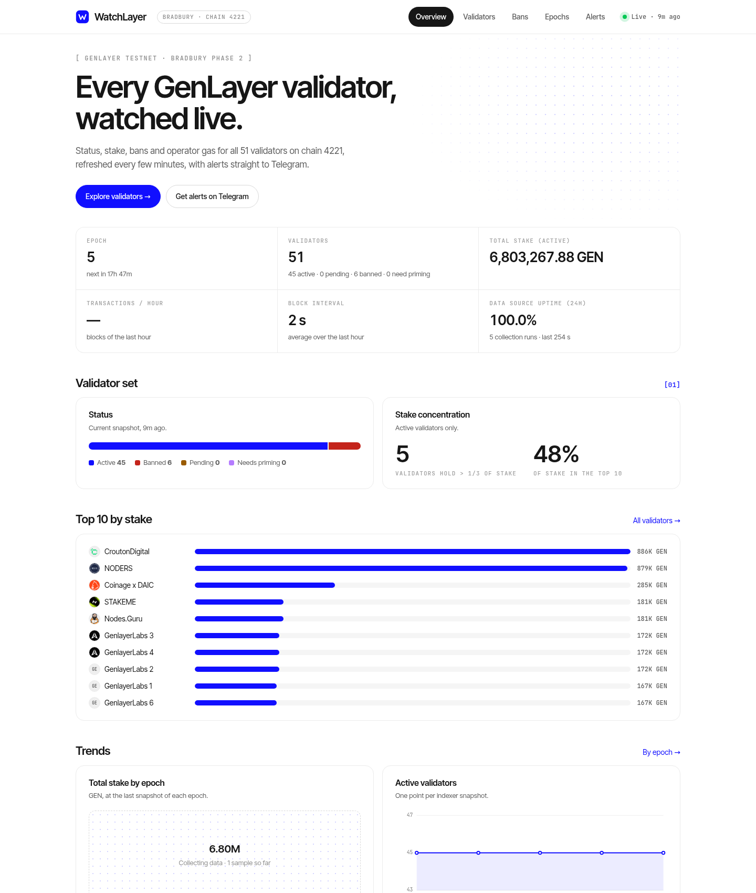
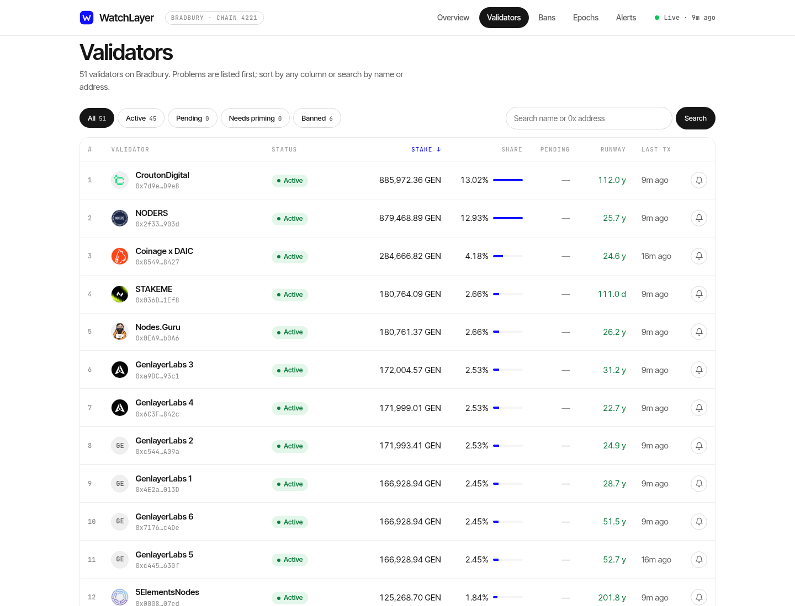
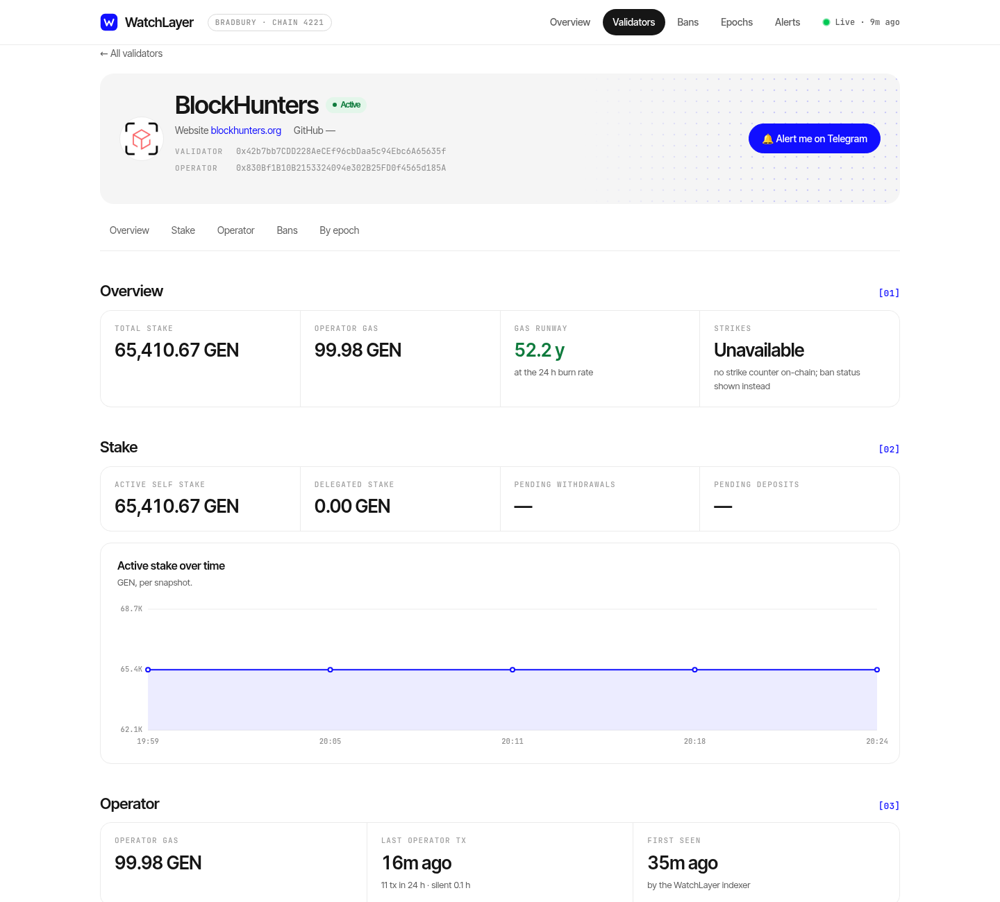
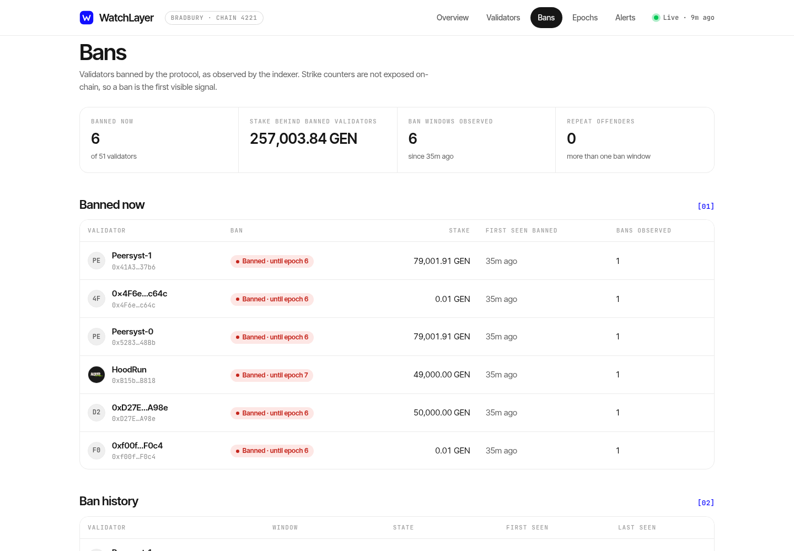
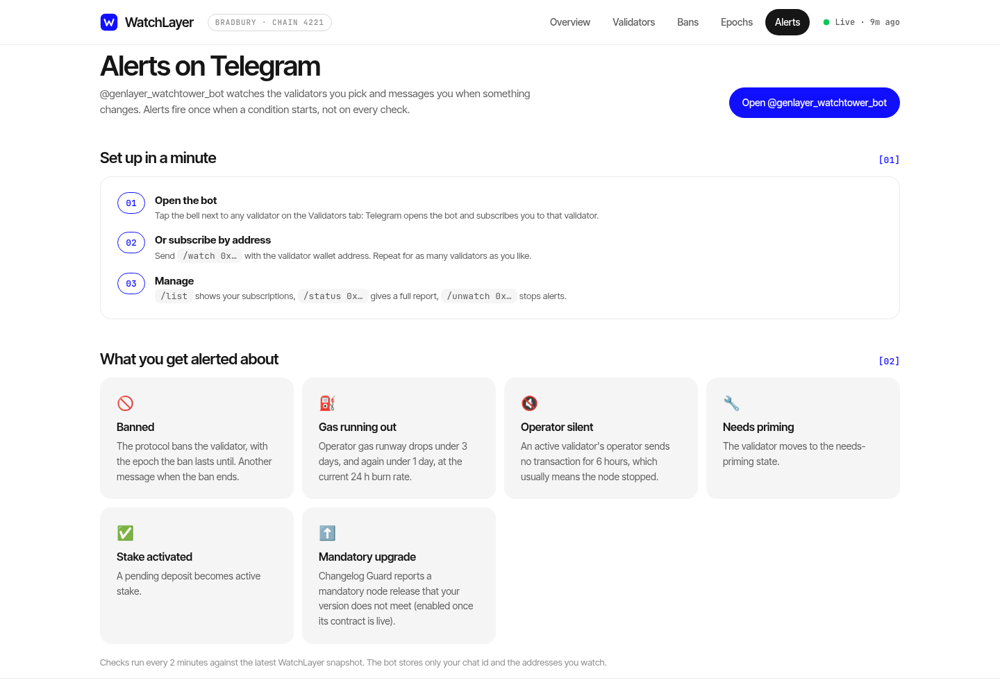

# WatchLayer

Validator monitoring for **GenLayer Testnet Bradbury**: a live dashboard and a Telegram alert bot for every validator on chain 4221.



## What it shows

- **Overview**: epoch and next-epoch estimate, validator counts by status, total active stake, block interval, data-source uptime, stake concentration (how many validators hold more than a third of active stake, share of the top 10), top validators by stake, trends and the validators banned right now.
- **Validators**: every validator with identity (moniker, logo, website, GitHub), status and ban window, active stake and share, pending deposits, operator gas runway and last operator transaction. Search by name or address, filter by status, sort by stake, name or runway.
- **Bans**: ongoing bans, every observed ban window, and validators banned more than once.
- **Epochs**: network state at the end of each epoch.
- **Validator page**: stake (self, delegated, pending deposits and withdrawals), operator gas and activity, history charts, ban timeline and per-epoch table.

Strike counters are not exposed by the Staking contract, so they are shown as unavailable and the ban state is used instead.

## Telegram alerts

[@genlayer_watchtower_bot](https://t.me/genlayer_watchtower_bot) messages you when a watched validator:

| Alert | When |
|---|---|
| Banned / ban ended | status changes to or from banned, with the epoch the ban lasts until |
| Gas running out | operator gas runway drops under 3 days, and again under 1 day |
| Operator silent | an active validator's operator sends no transaction for 6 hours |
| Needs priming | status changes to needs priming |
| Stake activated | a pending deposit becomes active |
| Mandatory upgrade | optional: a mandatory node release reported on-chain by Changelog Guard is newer than your node |

Alerts are edge-triggered: one message when a condition starts, another when it clears.

Commands: `/watch 0x…`, `/unwatch 0x…`, `/list`, `/status 0x…`. The bell next to each validator on the dashboard opens the bot with `/start 0x…`, which subscribes you directly.

## Architecture

```
public GenLayer RPC (HTTP) ──> packages/indexer ──> SQLite ──> JSON API ──┬──> apps/dashboard (Next.js)
                                                                          └──> packages/bot (grammY, Telegram)
```

- `packages/indexer` reads the Staking contract and validator identities over the public HTTP RPC, one pass at a time (the public endpoint rate-limits parallel calls), stores snapshots in SQLite, keeps the last snapshot of every epoch, and serves a read-only JSON API ([docs/API.md](docs/API.md)).
- `apps/dashboard` renders the API server-side; no client-side data fetching.
- `packages/bot` polls the API and sends alerts; it stores only chat ids and watched addresses.

No private key, node access or WebSocket key is used anywhere.

## Run it

Requirements: Node.js 22.5 or newer.

```bash
npm install
cp .env.example .env            # set TELEGRAM_BOT_TOKEN for the bot; everything else has defaults
npm test

npm run dev:indexer             # API on :20360; first snapshot after a few minutes
API_URL=http://127.0.0.1:20360 npm run build -w @watchlayer/dashboard
API_URL=http://127.0.0.1:20360 DASHBOARD_PORT=3000 npm run start -w @watchlayer/dashboard
npm run dev -w @watchlayer/bot  # reads ../../.env
```

Configuration (`.env`): `RPC_URL`, `CHAIN_ID`, `DB_PATH`, `PORT`, `POLL_SECONDS` (delay after each pass, default 120), `RETENTION_DAYS`, and for the bot `TELEGRAM_BOT_TOKEN`, `API_URL`, `BOT_DB_PATH`, `ALERT_CHECK_SECONDS`, `SILENT_HOURS`. Mandatory-upgrade alerts are described in [docs/UPGRADE-ALERT.md](docs/UPGRADE-ALERT.md).

## Limits

- History starts when the indexer first runs; there is no backfill.
- Gas runway needs two snapshots with a balance drop before it shows.
- Data is as fresh as the last indexer pass (a few minutes on the public RPC).

## Screenshots

| Validators | Validator page |
|---|---|
|  |  |
| **Bans** | **Alerts** |
|  |  |

Built by [BlockHunters](https://blockhunters.org). Released under the [MIT License](LICENSE).
